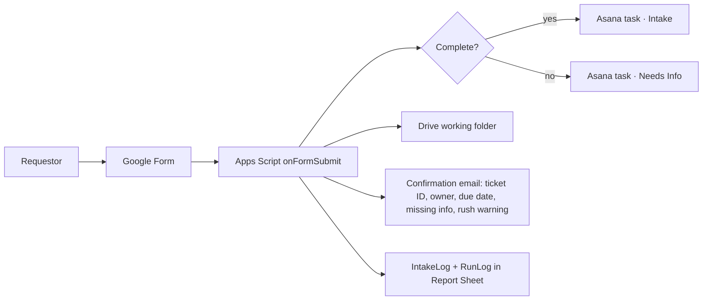

# Marketing Request Pipeline & Asset Library for SFU WiCS

A Google Forms → Asana intake pipeline, a Google Sheets workload report, and an organized Drive asset library for the SFU Women in Computing Science marketing team. Built with Google Apps Script.

> 🚧 **In progress.** Sprint 1 (intake) is written and unit-tested; live setup is next. See [`docs/SPRINT_LOG.md`](docs/SPRINT_LOG.md).

## How intake works


- **Routing is config, not code:** a `Routing` tab in the Sheet maps request type → owner and lead time.
- **Rush detection:** needed-by dates inside a type's lead time get tagged `Rush` and priority P1.
- **Safe to re-run:** the form response ID guards against duplicate tickets; Asana calls retry with backoff on 429/5xx.
- **Asana free plan:** no custom fields, so request details are stored as tags plus a structured task description.

## Repo
```
src/     Apps Script source (pushed with clasp)
tests/   Jest unit tests for the pure intake rules
docs/    SETUP.md, SPRINT_LOG.md
```

Setup: [`docs/SETUP.md`](docs/SETUP.md) · Tests: `npm test`

## License
MIT
