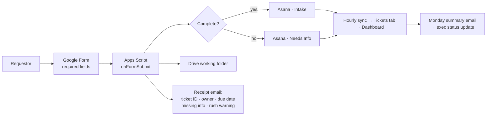

# Marketing Request Pipeline & Asset Library for SFU WiCS

A Google Forms → Asana request pipeline, a Google Sheets workload report and an organized Drive asset library for the SFU Women in Computing Science marketing team. Built with Google Apps Script.

**Who it's for:** the WiCS marketing team and everyone who asks them for creative work: event leads, program leads, the exec team and sponsors. Requests used to arrive through scattered DMs. Now every request has an owner, a due date and a status anyone can check.

## How a request flows


- **Required fields + completeness check:** a short description, "TBD" copy, missing references on design-heavy work, or a missing event date sends the ticket to **Needs Info**, and the email lists exactly what's missing.
- **Routing by request type** (owner + lead time) comes from a `Routing` tab. Too-soon dates get tagged **Rush**.
- **Dashboard:** overdue, due in 48h, due this week, workload spikes, same-day scheduling conflicts, cycle time, on-time %, status lookup, charts and a pivot table.
- **Asset library:** folder map, naming convention and a searchable index, built on a sandbox copy. The original Drive is read-only to the script.

## Screenshots
Redacted screenshots live in [`docs/results/`](docs/results/): form, Asana board, ticket, Dashboard, Search tab, Drive before/after, sample emails. See the checklist in [`docs/results/README.md`](docs/results/README.md).

## Results
| Metric | Result | Source |
|---|---|---|
| Requests tracked (intake → delivery) | _measured — see [docs/results/counts.md](docs/results/counts.md)_ | Dashboard |
| Creative assets organized | _measured — see [docs/results/counts.md](docs/results/counts.md)_ | Index tab |
| Weekly status update time (before → after) | _see [docs/results/timing.md](docs/results/timing.md)_ | Stopwatch, real weeks |

## Setup
- [`docs/SETUP.md`](docs/SETUP.md): Apps Script + clasp, Form, Report Sheet, Asana, smoke tests, going live
- [`docs/BACKFILL.md`](docs/BACKFILL.md): importing real past requests
- [`docs/LIBRARY.md`](docs/LIBRARY.md): sandbox copy, restructure plan, undo
- [`docs/REPORT.md`](docs/REPORT.md): every Dashboard formula explained

`npm install` · `npm test` runs the Jest unit tests for the pure logic.

## Design decisions
- **Asana + Sheets, not a custom app.** The team already uses Google Workspace, and Asana is what creative teams use. Anyone can read the board and the formulas, and nobody depends on one person to maintain an app.
- **Dry run + undo log + Google-enforced read-only on the original Drive.** The library script can only *read* the original (Google permission `drive.readonly`) and *edit only files it created* (`drive.file`). Every move is checked against the sandbox root, the full plan is approved by a person first, every change is logged and reversible, and nothing is ever deleted.
- **Config-driven routing.** Owners and lead times live in a Sheet tab, so the team can change them without touching code.

More in [`docs/DESIGN.md`](docs/DESIGN.md).

## How I built this with AI tools
I built this with **Claude Code** (Anthropic) as a pair programmer.

- **Claude Code wrote** most of the Apps Script code, the Jest tests and the first drafts of these docs.
- **I (Asmi)** defined the requirements from our real WiCS workflow and the creative-ops coordinator role. I made the decisions, for example:
  - the original WiCS Drive had to be untouchable, which led to Google-enforced read-only permissions rather than relying on code checks alone;
  - granting the command-line deploy tool (clasp) only the minimum permissions.

  I ran every setup step, smoke test and real submission on our accounts, and reviewed what came back.
- **Mistakes we caught:**
  - The deploy tool silently overwrote the project manifest with default (broader) permissions. We caught it in the git diff before pushing and restored the narrow ones.
  - A stale "Untitled section" entry showed up in the `checkSetup` output after creating the Asana board. It was flagged and fixed.
  - The first plan asked for full Google Drive access. I pushed back, and it was narrowed to "only files this app created".

## What I'd change at a studio's scale
Per-title intake and routing; Asana custom fields and portfolios; capacity planning per artist; a vendor/PO workflow; a real DAM (e.g. Bynder) with rights metadata instead of Drive; formal licensor approval rounds with SLAs. See [`docs/DESIGN.md`](docs/DESIGN.md#what-would-change-at-a-studios-scale).

## Repo layout
```
src/         Apps Script source (pushed with clasp)
tests/       Jest unit tests for the pure logic
templates/   backfill.csv, meeting-notes template
docs/        SETUP, DESIGN, REPORT, BACKFILL, LIBRARY, wiki/, results/, SPRINT_LOG
```

## License
MIT. See [LICENSE](LICENSE).
