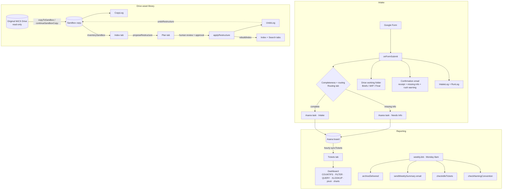

# Design

## System overview

## Functions you run (Apps Script editor)
| Area | Functions |
|---|---|
| Setup | `setupGoogleSide`, `setupAsanaTestProject`, `setupAsanaLiveProject`, `installFormTrigger`, `useTestMode` / `useLiveMode`, `checkSetup`, `runSmokeTests` |
| Backfill | `setupBackfillTab`, `importBackfill` |
| Report | `syncTickets`, `archiveDelivered`, `setupDashboard`, `sendWeeklySummary`, `weeklyJob`, `installReportTriggers`, `checkIdleTickets` |
| Library | `setupLibraryTabs`, `copyToSandbox`, `continueSandboxCopy`, `inventorySandbox`, `proposeRestructure`, `applyRestructure`, `undoRestructure`, `rebuildIndex`, `checkNamingConvention` |
| Trackers and docs | `setupTrackerTabs` (Vendors + Approvals), `createWikiDoc`, `createMeetingNotesTemplate` |

**Report Sheet tabs:** Dashboard, Tickets, IntakeLog, RunLog, Routing, Backfill, ChartData, CopyLog, Index, Search, Plan, UndoLog, Events, Sponsors, Vendors, Approvals.

## Decisions

**Asana + Google Sheets, not a custom app.** The team already works in Google Workspace, and Asana is a standard tool for creative teams. Anyone on the team can open the board or click a Dashboard formula to see how it works, and nobody depends on me to maintain an app.

**Config-driven routing.** The Routing tab maps request type → owner, lead time, "needs references?" and "needs event date?". Changing who owns Reels, or how much notice a poster needs, is a Sheet edit, not a code change. A blank owner falls back to the Default row, then to the coordinator, so a gap in the config never loses a request.

**Idempotency.** Each form response ID is written to IntakeLog before the email goes out, and checked before creating a task. Backfilled rows use a hash of date + type + event + description, stored per mode (test/live). Re-running a submission or an import never creates duplicates. A script lock stops two simultaneous submissions racing each other.

**Tags + structured descriptions (Asana free plan).** Custom fields need a paid Asana plan. Fields are stored as tags (`type: Reel`, `source: form|backfill`, `P1`–`P3`, `Rush`, `Needs Info`, `Sponsor`) for filtering, plus `Label: value` lines in the description (`Needed by:`, `Requested date:`, `Delivered date:`…) that the sync parses back. On a paid plan these would become real custom fields.

**Asana is the source of truth.** The Tickets tab is wiped and rebuilt from Asana every hour. Whatever people change on the board (moves, reassignments, new dates) always wins, and the report can't drift.

**Delivered-date stamping.** The first time the sync sees a card in Delivered or Archived, it writes `Delivered date:` into the task. Asana's own completion timestamp would be wrong for backfilled tasks, which are completed on import day, and that would distort cycle time and on-time %.

**Safety on the original Drive: enforced by Google, not just our code.**
- **Scopes:** the library code gets `drive.readonly`, to read the original, and `drive.file`, to edit only files the script itself created. Google refuses any write to the original, even if a line of code were wrong.
- **Code guard:** every move/rename calls `assertInSandbox_`, which refuses any file not under the sandbox root. It has a unit test.
- **Never delete:** restructuring is move + rename only. Unclassifiable files go to `99_Archive`.
- **Dry run first:** `proposeRestructure` writes every proposed path and name to the Plan tab. Nothing moves until a person has reviewed and approved it.
- **Undo log:** every applied change is logged, and `undoRestructure` reverses all of them.

**Resumable batches.** Apps Script stops after 6 minutes. Copying, inventory, applying the plan and backfill import all stop safely before the limit and continue on the next run. Progress is tracked in the logs.

**Pure logic, tested separately.** Decisions (completeness, routing, rush, priority, notes parsing, spikes/conflicts, naming parser, sandbox guard) are plain functions in `src/logic.js` with no Google calls, tested with Jest. `runSmokeTests` checks the live wiring against a separate TEST board and refuses to run in live mode.

**Test vs live boards.** The `MODE` property switches between the `[TEST]` board and the real one, so test tickets never count toward real numbers.

## What would change at a studio's scale
- **Multiple titles:** a title/campaign field on intake, routing per title team, and Asana portfolios to see all titles at once.
- **Asana custom fields** instead of tags + description parsing, plus Asana rules and forms natively.
- **Capacity planning** per artist (hours, not just ticket counts), and spikes based on effort.
- **Vendor portal / PO workflow:** purchase orders, invoice matching and payment status in a finance tool, not a Sheet tab.
- **A real DAM** (e.g. Bynder) instead of Drive: metadata, rights and expiry, licensor-approved versions, renditions per channel.
- **Licensor approval workflows** with formal rounds, SLAs and an audit trail, linked to each asset version.
- **SSO and permissions** per team instead of individual sharing.
